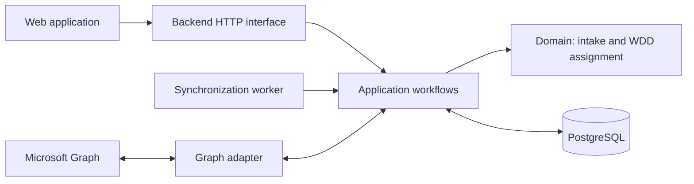

# Mail Dispatcher

An evolving mailbox intake and workload assignment platform. The intended system connects to authorized Microsoft 365 mailboxes through **Microsoft Graph**, keeps a consistent record of incoming work, and distributes cases across available specialists.

> **Project status: architecture transition.** The repository currently contains a working-area legacy Python/Playwright implementation. The Microsoft Graph monorepo described below is a **proposal, not a running replacement**. No migration or deployment has occurred.

## Direction

The next version aims to:

- Read folders, messages, and conversation metadata through Microsoft Graph instead of automating Outlook's web interface.
- Synchronize mailbox changes incrementally and persist normalized records in PostgreSQL.
- Keep workload assignment as a separate business capability, preserving the intent of the existing Weighted Deficit Dispatch (WDD) algorithm.
- Provide a web interface for intake visibility, assignments, specialist availability, and processing status.
- Make external operations observable, retryable where safe, and auditable without exposing mailbox contents in logs.

Microsoft Graph is a provider integration, not the domain model. A conversation is an application-level aggregate of messages; it is **not** a Graph endpoint for moving whole conversations. Write operations must account for individual messages and permissions.

## Proposed monorepo

```text
mail-dispatcher/
├── backend/            # Planned TypeScript/Fastify API, Graph adapter, jobs, and assignment logic
├── frontend/           # Planned TypeScript/React web application
├── database/           # Planned PostgreSQL schema and versioned migrations
├── docs/
│   └── MIGRATION_PLAN.md
├── AGENTS.md           # Rules and implementation boundaries for coding agents
└── README.md
```

These directories are **documentation placeholders**. They do not yet contain the new services or database migration scripts. Legacy source files remain in their existing locations until a separate, reviewed migration.

## Target architecture



- **Backend:** TypeScript with Fastify is the proposed baseline. Define provider-neutral application ports for mailbox access and persistence; connect infrastructure implementations at bootstrap.
- **Frontend:** React and TypeScript are proposed. It communicates with the backend, never directly with mailbox credentials or database connections.
- **Database:** PostgreSQL owns durable synchronization cursors, normalized messages and conversations, specialist configuration, assignments, and operation history.
- **Authentication:** use supported Microsoft Entra ID / OAuth flows with least-privilege delegated or application permissions, selected after the mailbox access scenario is confirmed. Do not automate sign-in or extract browser tokens.

## Migration principles

1. Establish an authorized Microsoft Graph authentication path before implementing mailbox reads or writes.
2. Prove folder/message retrieval and pagination; then implement per-folder delta synchronization and durable checkpoints.
3. Preserve WDD behavior through characterization tests before deciding how to port its implementation.
4. Introduce explicit idempotency keys, operation history, and recovery for assignment and mailbox changes.
5. Cut over only after tests and operator-controlled validation; retire the Playwright path in a **later** change.

The source of truth for execution order, constraints, and acceptance criteria is [the migration plan](docs/MIGRATION_PLAN.md). Coding agents must also read [AGENTS.md](AGENTS.md).

## Existing implementation (legacy)

The current repository still contains:

- `api/` — Python/Litestar HTTP service and assignment workflows.
- `agent/` — Outlook Web browser automation using Playwright.
- `wdd/` — pure-Python WDD engine and tests, including [its specification](wdd/ALGORITHM.md).
- `migrations/` and `esquema_mailreceiver.sql` — existing database artifacts.

The files `CLAUDE.md`, `DEPLOY.md`, `ENDPOINTS_MAP.md`, and `TODO.md` may describe the legacy workflow. They are not implementation instructions for the proposed Graph platform. Running the legacy application may still interact with a real mailbox; no Graph-backed quick-start command exists yet.

## Status and references

This is a public architectural proposal. Prior internal integrations and the earlier **TyFlow** prototype may inform design decisions, but they are not dependencies, and their source or operational settings are not included here.

Official references:

- [Microsoft Graph mail overview](https://learn.microsoft.com/en-us/graph/api/resources/mail-api-overview)
- [Access Microsoft Graph on behalf of a user](https://learn.microsoft.com/en-us/graph/auth-v2-user)
- [Incremental changes to messages in a folder](https://learn.microsoft.com/en-us/graph/delta-query-messages)
- [Microsoft Graph throttling guidance](https://learn.microsoft.com/en-us/graph/throttling)
- [Immutable Outlook identifiers](https://learn.microsoft.com/en-us/graph/outlook-immutable-id)
